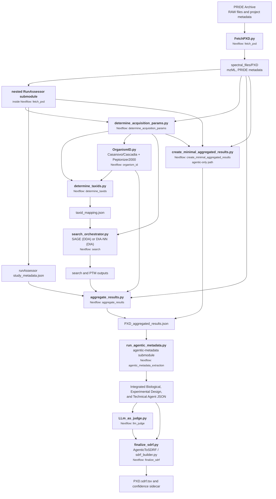
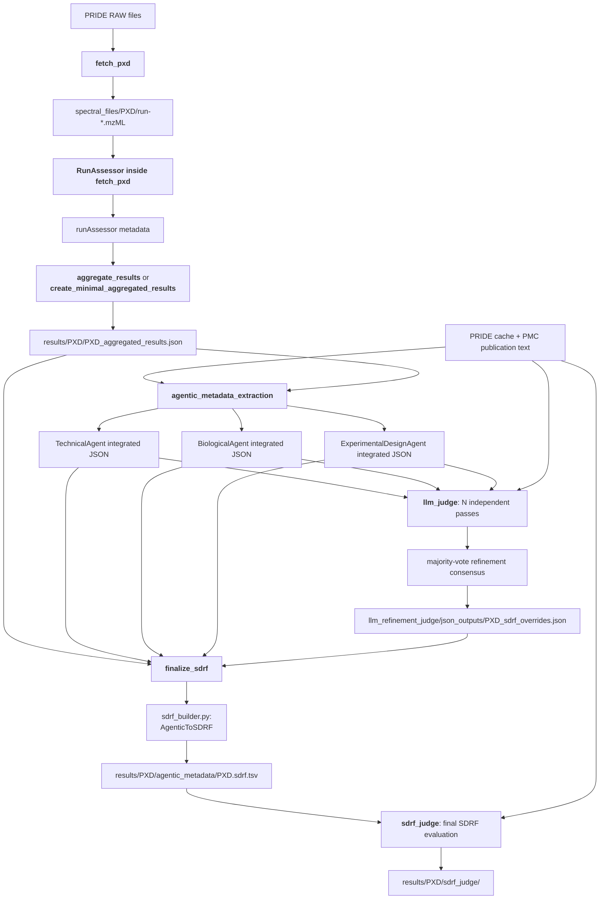

# HAMLET

**v3.0.1 migration:** fetch/conversion/RunAssessor and organism identification now
use [MassSpecOrganismID](submodules/MassSpecOrganismID). Sequencing uses installed
Casanovo/Cascadia packages, not the retained Bolt sources. See
[migration and installation notes](docs/organism-id-submodule.md). Real-PXD
validation of this release is pending.

**H**ybrid **A**gentic **M**etadata **L**iterature **E**xtraction and **T**echnical annotator

HAMLET is a local Nextflow DSL2 pipeline that processes PRIDE proteomics datasets end-to-end — from raw file download through database search — and produces a structured JSON report per experiment enriched with organism identity, instrument parameters, post-translational modifications, and optionally LLM- and agentic-extracted publication metadata.

## 1. Pipeline Structure and Installation

### Pipeline overview



### What HAMLET does

1. **Fetches** RAW files from PRIDE and converts them to mzML (via ThermoRawFileParser / ProteoWizard)
2. **Assesses** each run with runAssessor — detects acquisition type (DDA/DIA), labeling, instrument model, fragmentation
3. **Identifies organisms** through the MassSpecOrganismID submodule using installed Casanovo/Cascadia + patched Peptonizer2000, with PRIDE project organism metadata used to augment the taxid search pool
4. **Routes searches** automatically — DDA via SAGE, DIA via DIA-NN (controlled by `--acquisition_type`)
5. **Extracts publication metadata** via optional LLM prompting (`--run_llm_extraction`) and manifest-controlled downstream agentic stages
6. **Aggregates** all per-PXD outputs into a single `*_aggregated_results.json` report
7. **Generates SDRF** — the agentic pipeline can produce SDRF-Proteomics v1.1.0 TSV files via `src/python/run_agentic_metadata.py`

The pipeline is **100% container-free**, using conda environments for all tools.

### Checking archived aggregated results

`src/python/enrich_sections_from_tar.py` fills the five section/path columns in a
ROAR-enriched CSV using JSONs inside `.tar`, `.tar.gz`, or `.tar.zst` archives,
without extracting files. It streams each archive once, with one process per
archive (up to `--workers`). Compressed archives still require a full sequential
decompression scan; additional workers beyond the number of archives do not help.
For Zstandard, install `zstandard` in the Python environment used to run the script.

```bash
python3 -m pip install zstandard
python3 src/python/enrich_sections_from_tar.py \
  --csv Trackers/subset_nonzero_ROAR_sections.csv \
  --output Trackers/subset_nonzero_all_sections.csv \
  --workers 3 \
  --archive /scratch/ims86/HAMLET_ACCESS_CPU_vol2.tar.gz assets/FileLists/ACCESS_CPUv2_HAMLET_aggregated_results_10052026.json \
  --archive /scratch/ims86/HAMLET_ACCESS_GPU_vol1.tar.gz assets/FileLists/ACCESS_GPUv1_HAMLET_aggregated_results_10052026.json \
  --archive /scratch/ims86/HAMLET_store.tar.zst assets/FileLists/CyVerse_HAMLET_aggregated_results_10052026.json
```

Each `--archive` pairs an archive with its plain-text file list; confirm the store
archive contains the CyVerse-listed paths before using that pairing. Cluster root
prefixes are ignored, but paths below `HAMLETruns`, `results`, `store`, or `work`
must match, not just filenames. Unmatched relevant list entries are reported.
Symlink/hardlink members are not read as JSON candidates.

For each input PXD, the largest JSON wins across accessible ROAR files and listed
archive members; equal sizes prefer the newest filesystem/member modification
time, then the lexical location for deterministic ties. Existing ROAR paths must
remain accessible. The selected JSON alone determines the four `True`/`False`
nonempty-section indicators; archive locations are stored as `archive::member`.
Rows without a selected file remain unchanged. Malformed selected JSONs or
unreadable inputs fail explicitly, and the new CSV is published only after all
scans and CSV verification succeed. Existing output files are never overwritten.
Use the original ROAR-enriched CSV as input, not a previous archive-enriched output.

---

### Installation

### 1. Prerequisites

| Requirement | Notes |
|------------|-------|
| Linux (x86-64) | Tested on Ubuntu 22.04+ |
| [Nextflow](https://www.nextflow.io/docs/latest/install.html) ≥ 25.04 | `curl -s https://get.nextflow.io \| bash` |
| curl or wget | For Miniconda and file downloads |
| NVIDIA GPU | Optional — speeds up organism identification (Casanovo) |
| ~50 GB free disk | Per PXD (RAW files are 1–3 GB each) |

### 2. Clone and bootstrap

```bash
git clone <repo-url> HAMLET
cd HAMLET
bash src/setup.sh
```

`src/setup.sh` will:
- Install Miniconda if not already present (then ask you to re-run after `source ~/.bashrc`)
- Create four conda environments from [src/conda_envs/](src/conda_envs/):
  - `meti_env` — core tools: FetchPXD, SAGE, runAssessor, aggregation scripts
  - `search_env` — database search dependencies
  - `cascadia_env` — installed Cascadia DIA peptide identification runtime
  - `casanovo_env` — installed Casanovo DDA peptide identification runtime
- Verify key executables (`ThermoRawFileParser`, `aria2c`, etc.)
- Download NCBI taxonomy database files (nodes.dmp, names.dmp) for organism identification

### 3. Download the NCBI taxonomy database (required for organism identification)

The pipeline uses NCBI taxonomy files for deduplication during organism identification. These are downloaded automatically by `src/setup.sh`, but you can also download them manually:

```bash
bash src/bash/download_ncbi_taxonomy.sh
```

This downloads and extracts:
- `nodes.dmp` (206 MB) — NCBI taxid hierarchy
- `names.dmp` (277 MB) — NCBI taxid to organism name mapping

These files are required for accurate species-level organism identification but will fall back gracefully if missing (using simple taxid counting).

### 4. Download the Cascadia model (required for DIA)

The Cascadia checkpoint (558 MB) is stored separately from the repo:

1. Download `cascadia.ckpt` from [Google Drive](https://drive.google.com/drive/folders/1UTrZIrCdUqYqscbqga_KdX8kc8ZjMMfr?usp=sharing)
2. Place it in the repo:
   ```bash
   mv ~/Downloads/cascadia.ckpt assets/
   ```

If you only process DDA datasets you can skip this step.

### 5. Set the OpenRouter API key (required for LLM/agentic features)

```bash
export OPENROUTER_API_KEY="sk-or-..."
```

`OPENROUTER_API_KEY` is the only API credential HAMLET requires. HAMLET sends all LLM requests to OpenRouter. Add the export to `~/.bashrc` to make it persistent. The pipeline reads it from the environment — **never put API keys in source files**.

### 6. Verify setup

```bash
conda activate meti_env
which ThermoRawFileParser && which aria2c
python -c "import pandas, sage_runner; print('OK')"
conda deactivate
```

### 7. Optional: Apptainer/Singularity container

HAMLET is container-free by design (conda environments cover every tool), but an
[Apptainer](https://apptainer.org/) definition is provided so you can bake `meti_env`,
`search_env`, `casanovo_env`, `cascadia_env`, and the search tool binaries (SAGE,
PTM-Shepherd, Fragpipe/MSFragger, dotnet, DIA-NN) into a single image instead of running
`src/setup.sh` on the host. This is useful on shared HPC systems where you want a
reproducible, portable runtime without touching the host's conda installation.

The container does **not** bake in the HAMLET repo itself, its git submodules,
`assets/cascadia.ckpt`, or `assets/taxonomy/*.dmp` — those are bind-mounted from a real
checkout at runtime (most HPC sites already auto-bind `/storage`, `/scratch`, and `$HOME`
into containers; check your site's Apptainer/Singularity bind-path config if paths aren't
visible).

**Build the image** (from the repo root, since [containers/hamlet.def](containers/hamlet.def)
copies `src/conda_envs/*.yml` and `src/bash/install_search_tools.sh` using paths relative to
the build's working directory):

```bash
apptainer build --fakeroot containers/hamlet.sif containers/hamlet.def
```

**Test that you can reach and use the container.** `apptainer exec` treats every trailing
argument as the command to run *inside* the container, so `apptainer exec hamlet.sif --help`
fails with `executable file not found in $PATH` — there is no `--help` binary. Use this
instead to confirm the image is readable and its tools resolve:

```bash
apptainer exec /storage/group/epo2/default/software/HAMLET/containers/hamlet.sif bash -lc 'source /opt/conda/etc/profile.d/conda.sh; conda activate meti_env; command -v sage && command -v diann && command -v ThermoRawFileParser && sage --version && echo CONTAINER_OK'
```

A successful run prints the three tool paths, `sage 0.14.6`, and `CONTAINER_OK`. Any other
user on the HPC can run this same command against
`/storage/group/epo2/default/software/HAMLET/containers/hamlet.sif` from any directory —
no need to be inside this repo checkout.

**One-time runtime setup** — install the patched nested Peptonizer package into
the container's `meti_env` from the bind-mounted checkout:

```bash
apptainer exec containers/hamlet.sif /opt/conda/envs/meti_env/bin/python \
  src/python/install_organism_id.py --submodule submodules/MassSpecOrganismID
```

**Run the pipeline inside the container.** Use the `container_gpu` Nextflow profile (added
in [nextflow.config](nextflow.config)) to repoint `conda_init`/`meti_env_path`/
`casanovo_env_path`/`cascadia_env_path`/`search_env_path` at the environments baked into the
image (`/opt/conda/envs/*`), and combine it with the site profile(s) you'd otherwise use
(e.g. `roar_basic,roar_basic_gpu`). Launch `nextflow` itself via `apptainer exec --nv` so
the local executor's child processes inherit the container's environment and GPU access:

```bash
apptainer exec --nv containers/hamlet.sif bash -lc "
  source /opt/conda/etc/profile.d/conda.sh
  conda activate meti_env
  nextflow run main.nf \
    -profile roar_basic,roar_basic_gpu,container_gpu \
    --pxd PXD000070 \
    -resume
"
```

See [PXD073162GPU.slurm](PXD073162GPU.slurm) for a full working example that runs this way
under SLURM — it runs the casanovo-data fixup once, then wraps the entire `nextflow run`
invocation (fetch → organism ID → search → LLM/agentic metadata) in `apptainer exec --nv`.

---

## 2. Pipeline Usage Modes

### Single PXD

```bash
nextflow run main.nf --pxd PXD000070
```

### Single PXD — limit files (for quick testing)

```bash
nextflow run main.nf \
  --pxd PXD000070 \
  --max_raw_files 3 \
  -resume
```

### Globus download and runAssessor-only mode

Use `--globus` to transfer selected PRIDE RAW files from the EMBL-EBI Public Data collection. The Globus CLI must be authenticated, and Globus Connect Personal must expose `--central_mzml_dir` on the destination host.

Use `--mode 'runassessor only'` to run combined `fetch_pxd`/RunAssessor and write
the PXD's aggregated-results JSON, then stop. No organism identification,
database search, or agentic processes are launched.

```bash
nextflow run main.nf \
  -c assets/nextflow_configs/nextflow_JS2.config \
  --pxd PXD000070 \
  --globus \
  --mode 'runassessor only' \
  --max_raw_files 1 \
  -resume
```

### Batch from CSV

The CSV must have a `PXD` column:
```csv
PXD
PXD000070
PXD000312
PXD000534
```

```bash
nextflow run main.nf \
  --pxd_csv master.csv \
  --num_pxds 10 \
  --max_raw_files 5 \
  -resume
```

### Using pre-configured test datasets

Test PXD lists are available in [assets/pxd_test_files/](assets/pxd_test_files/) for validation and CI/CD:

| Dataset | Count | Purpose |
|---------|-------|---------|
| `ConsolidatedTestPXDs.csv` | 142 | Comprehensive test — all validated test PXDs |
| `GoldStandardSDRFs.csv` | 101 | Production validation — datasets with known-good SDRFs |
| `PXDsTest.csv` | 2 | Quick smoke test for CI/CD pipelines |
| `PXDsingle.csv` | 1 | Single-PXD debugging |

**Quick test with 2 PXDs (fast validation):**
```bash
nextflow run main.nf \
  --pxd_csv assets/pxd_test_files/PXDsTest.csv \
  --max_raw_files 3 \
  -resume
```

**Comprehensive test with 20 datasets:**
```bash
nextflow run main.nf \
  --pxd_csv assets/pxd_test_files/ConsolidatedTestPXDs.csv \
  --num_pxds 20 \
  --max_raw_files 5 \
  -resume
```

See [assets/pxd_test_files/README.md](assets/pxd_test_files/README.md) for detailed information about each test set.

### Pipeline modes and updating existing results

Select one mode with `--mode` (default: `full`). Quote names containing spaces;
equivalent underscore or hyphen spellings are also accepted.

| Mode | Work performed | Stops after |
|------|----------------|-------------|
| `full` | Fetch/assessment, organism ID, search, aggregation, agentic/judge/SDRF | SDRF finalization |
| `runassessor only` | Fetch/assessment and aggregation | Aggregated-results JSON |
| `organism only` | Fetch/assessment, acquisition detection, organism ID, aggregation | Aggregated-results JSON |
| `search only` | Fetch/assessment, acquisition detection, taxid selection, search, aggregation | Aggregated-results JSON |
| `agentic only` | Reuse stored aggregates; run agentic extraction, judge, SDRF | SDRF finalization |

The old `--agentic_only`, `--runAssessorOnly`, `--run_organism_id`,
`--run_search`, and `--run_agentic_metadata` flags have been removed; supplying
them fails with a migration message. Regenerate previously generated job scripts.

To refresh one stage while preserving the other aggregate sections:

```bash
nextflow run main.nf --pxd PXD000070 --mode 'search only' \
  --update_from_existing true \
  --existing_results_dir /path/to/prior/results \
  --outdir /path/to/new/results
```

Update mode uses
`<existing_results_dir>/<PXD>/<PXD>_aggregated_results.json` as its base.
Organism-only replaces organism identification; search-only replaces search/PTM
results, modification-site fractions, and taxid warnings; RunAssessor-only
replaces RunAssessor and PRIDE metadata. Other sections, including custom data
and prior publication metadata, survive even when their source files are gone.
Version, run mode, aggregation timestamp, relevant input paths, and processing
summary are refreshed. Search-only can also recover taxid evidence from the
embedded organism predictions and metadata if original source files are missing.
Full update refreshes all main stages but retains extra fields and existing
LLM-extracted metadata when no replacement is available.

If the base aggregate is absent, HAMLET explicitly reports this and rebuilds
from available stage outputs, including reusable prior stage directories.
Malformed aggregates or mismatched PXD IDs fail rather than silently discarding
data. The prior directory is never overwritten: `--outdir` must differ from
`--existing_results_dir`. Spectra and tools needed for the selected stage are
still required; missing spectra are fetched as usual.

### Manifest-driven stage control

HAMLET now uses `results/pipeline_stage_manifest.json` as the single source of truth for per-PXD stage execution.

- `--mode` selects which stages are eligible to run; partial modes always stop at aggregation.
- On each run, HAMLET reconciles the manifest from existing outputs.
- RunAssessor runs inside the combined fetch task; its separate `run_assessor` manifest record still supports independent reruns on cached spectra.
- Per stage, each PXD has:
  - `availability`: whether the stage is allowed to run
  - `complete`: computed from checkpoint files
  - `key_outputs`: checkpoint file patterns used to determine completion

### RunAssessor within MassSpecOrganismID

MassSpecOrganismID uses its pinned nested RunAssessor dependency. Initialize it with:

```bash
git submodule update --init --recursive submodules/MassSpecOrganismID
```

The retained legacy `run_assessor` process and its script override are not used
by the v3.0.1 workflow.

Default behavior for a normal run:

```bash
nextflow run main.nf --pxd_csv master.csv -resume
```

Force acquisition mode or provide fallback taxid:

```bash
nextflow run main.nf \
  --pxd PXD000070 \
  --acquisition_type DDA \
  --taxid 9606 \
  -resume
```

### Example: disable a stage for one PXD in the manifest

```bash
python - <<'PY'
import json
from pathlib import Path

mf = Path('results/pipeline_stage_manifest.json')
data = json.loads(mf.read_text())
data['pxds']['PXD000070']['stages']['llm_judge']['availability'] = False
mf.write_text(json.dumps(data, indent=2))
print('Updated manifest: disabled llm_judge for PXD000070')
PY
```

### With optional LLM extraction

```bash
export OPENROUTER_API_KEY="sk-or-..."

nextflow run main.nf \
  --pxd_csv master.csv \
  --run_llm_extraction true \
  -resume
```

---

### Standalone SDRF generation

After the pipeline produces `*_aggregated_results.json` outputs, you can generate SDRF-Proteomics v1.1.0 TSV files independently using the agentic metadata script.

**Run the agentic extraction + SDRF conversion for one PXD:**

```bash
python src/python/run_agentic_metadata.py \
  --input results/PXDxxxxxx/PXDxxxxxx_aggregated_results.json \
  --outdir store/agentic_results_files/PXDxxxxxx/ \
  --pride_cache pride_survey/pride_cache \
  --pmc_cache pride_survey/pmc_cache
```

Output: `store/agentic_results_files/PXDxxxxxx/sdrf.tsv`

**Batch run with parallelism (requires GNU parallel):**

```bash
parallel -j 10 < run_agentic_metadata.cmds
```

---

### PRIDE survey (`src/python/pride_survey.py`)

`pride_survey.py` is a standalone utility for surveying all public PRIDE projects, building a master dataset, and slicing it into analysis subsets. It runs in three explicit stages that can be invoked independently or combined.

### Stages

| Flag | Stage | Description |
|------|-------|-------------|
| `--update_caches` | 1 — Update caches | Fetches all PRIDE projects (paginated) and PMC full-text for each project that has a PubMed ID. Results are stored in `<outdir>/pride_cache` and `<outdir>/pmc_cache`. Already-cached entries are skipped. |
| `--build_master` | 2 — Build master.csv | Reads the caches and produces `master.csv` with one row per PRIDE project, including organism names, taxids, raw file count, experiment types, publication license, and reannotation status flags. |
| `--parse_subsets` | 3 — Parse subsets | Reads master.csv, writes analysis subset CSVs (e.g. LiP-MS projects), and runs LLM analysis on each subset using `<outdir>/llm_cache`. |

### Arguments

| Argument | Default | Description |
|----------|---------|-------------|
| `--update_caches` | off | Run Stage 1: fetch/refresh PRIDE and PMC caches |
| `--build_master` | off | Run Stage 2: build master.csv from caches |
| `--parse_subsets` | off | Run Stage 3: parse subsets and run LLM analysis |
| `--outdir` | `./pride_survey/` | Directory containing `pride_cache`, `pmc_cache`, `llm_cache`, and subset CSVs |
| `--master` | `./master.csv` | Path to write (Stage 2) or read (Stage 3) master.csv |
| `--prompt` | `assets/prompts/minimal_lipms.txt` | LLM prompt file used in Stage 3 |

### Columns in master.csv

| Column | Source | Description |
|--------|--------|-------------|
| `accession` | PRIDE | PXD accession |
| `pubmed_id` | PRIDE references | PubMed ID of the associated publication |
| `pmc_id` | PMC cache | PMC ID resolved from the PubMed ID |
| `raw_file_count` | PRIDE files | Number of `.raw` files in the project |
| `organism` | PRIDE organisms | Semicolon-separated organism names |
| `taxids` | PRIDE organisms | Semicolon-separated NCBI taxids (from `NEWT:XXXXX` accession codes) |
| `experiment_types` | PRIDE experimentTypes | Semicolon-separated experiment type names |
| `pub_license` | PMC full-text response | Open-access license (e.g. `CC BY`, `CC BY-NC-ND`) |
| `Reannotated` | — | Boolean flag for tracking reannotation status |
| `Reannotation_QC` | — | Boolean flag for tracking QC status |

### Usage examples

**Stage 1 only — refresh caches:**
```bash
python src/python/pride_survey.py --update_caches --outdir pride_survey/
```

**Stage 2 only — build master.csv from existing caches:**
```bash
python src/python/pride_survey.py \
  --build_master \
  --outdir pride_survey/ \
  --master master.csv
```

**All stages in one run:**
```bash
python src/python/pride_survey.py \
  --update_caches \
  --build_master \
  --parse_subsets \
  --outdir pride_survey/ \
  --master master.csv \
  --prompt assets/prompts/minimal_lipms.txt
```

**Using a separate output directory (e.g. for a dated survey run):**
```bash
python src/python/pride_survey.py \
  --build_master \
  --outdir pride_survey_06022026/ \
  --master pride_survey_06022026/master.csv
```

> **Note:** `pride_cache` (~hundreds of MB) and `pmc_cache` (~2.5 GB) are large binary JSON files stored in `--outdir`. Stage 1 is incremental — running `--update_caches` again will only fetch projects not already in `pmc_cache`.

---

### Parameters

### Input

| Parameter | Default | Description |
|-----------|---------|-------------|
| `--pxd` | — | Single PRIDE accession (mutually exclusive with `--pxd_csv`) |
| `--pxd_csv` | — | CSV file with a `PXD` column |
| `--num_pxds` | all | Limit how many PXDs to read from `--pxd_csv` |

### Download & conversion

| Parameter | Default | Description |
|-----------|---------|-------------|
| `--max_raw_files` | `30` | Max RAW files per PXD (`null` = all) |
| `--globus` | `false` | Transfer PRIDE RAW files using Globus instead of aria2c/wget |
| `--globus_source_collection` | EMBL-EBI Public Data | Source Globus collection UUID |
| `--globus_destination_collection` | local collection | Destination UUID; discovered with `globus endpoint local-id` when unset |
| `--globus_destination_base` | `central_mzml_dir` | Destination collection path corresponding to central storage |
| `--use_aria2c` | `true` | Parallel downloads via aria2c |
| `--aria2c_threads` | `16` | aria2c concurrency per download |
| `--download_timeout` | `4h` | Timeout for download + mzML conversion |
| `--max_parallel_pxds` | `10` | Max PXDs fetched at the same time |

### Output

| Parameter | Default | Description |
|-----------|---------|-------------|
| `--outdir` | `results` | Published results directory |
| `--central_mzml_dir` | `spectral_files` | Central store for converted mzML files |

### Acquisition routing

| Parameter | Default | Description |
|-----------|---------|-------------|
| `--acquisition_type` | `AUTO` | `AUTO`, `DDA`, or `DIA` |
| `--auto_detect` | `true` | Use runAssessor to detect acquisition type and labeling |

### Search

| Parameter | Default | Description |
|-----------|---------|-------------|
| `--taxid` | unset | Fallback taxid if organism detection fails |
| `--sage_config` | `assets/default_sage.config` | SAGE search configuration |
| `--search_min_ptm_psms` | `50` | Min PSMs for a PTM to be included |
| `--search_max_variable_mods` | `3` | Max variable-mod residue types per search |
| `--high_confidence_q_threshold` | `0.01` | spectrum_q threshold for high-confidence PSMs |
| `--min_high_confidence_peptides` | `10` | Min high-confidence PSMs before running PTM-Shepherd |

### Organism identification

| Parameter | Default | Description |
|-----------|---------|-------------|
| `--denovo_threshold` | `70` | Min Casanovo/Cascadia peptide confidence |
| `--min_peptides_for_peptonizer` | `5` | Min peptides required to run Peptonizer2000 |
| `--contaminants_fasta` | `assets/UniversalContaminats.fasta` | Contaminant sequences |
| `--taxid_list_file` | `assets/taxid_lists/CommonPRIDEtaxids.txt` | Allowed taxid list |
| `--organism_id_all` | `false` | Run organism identification on all files even when one representative file would suffice |
| `--num_gpus` | `2` | Number of GPUs for de novo sequencing (controls `maxForks` + `CUDA_VISIBLE_DEVICES` assignment; set to `0` or `1` for single-GPU systems) |

### Metadata extraction

| Parameter | Default | Description |
|-----------|---------|-------------|
| `--run_llm_extraction` | `false` | LLM-based metadata extraction from publications |
| `--n_judge_runs` | `3` | Number of LLM judge runs for consensus |
| `--stage_manifest` | `results/pipeline_stage_manifest.json` | Per-PXD stage availability/completion manifest |
| `--pride_database_path` | `/THISPATHDOESNOTEXIST` | Path to local PRIDE publication text database |
| `--llm_prompt_file` | `src/BaselinePrompt.txt` | Prompt template for LLM extraction |
| `--llm_workers` | `1` | Parallel LLM API calls per PXD |

### runAssessor stage

| Parameter | Default | Description |
|-----------|---------|-------------|
| `--mode` | `full` | Select one of the five pipeline modes above |
| `--runassessor_submodule_dir` | `submodules/runassessor` | Preferred runAssessor submodule directory |
| `--organism_id_submodule_dir` | `submodules/MassSpecOrganismID` | Standalone fetch and organism-ID source |

### Tool paths

| Parameter | Default | Description |
|-----------|---------|-------------|
| `--conda_base` | `~/miniconda3` | Conda installation prefix |
| `--cascadia_model_path` | `assets/cascadia.ckpt` | Cascadia DIA model checkpoint |
| `--peptonizer2000_host_path` | `src/Peptonizer2000` | Peptonizer2000 source directory |

---

## 3. Store and Per-PXD Contents

### Runtime output layout

Converted spectra have one canonical location under `--central_mzml_dir` (default: `spectral_files`). A downloaded RAW file is deleted only after its same-stem mzML file passes validation. The full pipeline and `--mode 'runassessor only'` both use this same storage policy.

```text
spectral_files/
└── PXDxxxxxx/
  ├── run-01.mzML                         # Canonical spectrum file
  ├── PXDxxxxxx_PRIDEmetadata.json
  ├── pmc_json/
  └── runAssessor/
    └── study_metadata.json
```

Spectral directories are not copied into `--outdir`. Each processed PXD publishes derived results only:

```
results/
└── PXDxxxxxx/
    ├── organism_results/                    # Casanovo + Peptonizer2000 outputs
    ├── search/                              # SAGE or DIA-NN search results
    ├── llm_results/                         # LLM-extracted metadata (if enabled)
    ├── agentic_metadata/                    # Agentic enrichment outputs (if enabled)
    ├── taxid_mapping.json
    ├── taxid_warnings.json
    └── PXDxxxxxx_aggregated_results.json    # ← main output
```

The `*_aggregated_results.json` is the primary deliverable: a single document with runAssessor data, organism identification, search results, PTM fractions, PRIDE metadata, and optionally LLM/agentic enrichments.

### Agentic metadata, judge, and SDRF flow

The final SDRF is generated from the per-PXD runtime outputs under `results/`; `store/` is an archival layout and is not an input to this workflow. The builder combines the aggregated results JSON with all three integrated agent JSONs. It does not use a raw agent response directly.



By default, **`llm_judge`** makes three independent evaluations (`--n_judge_runs 3`) against publication text and the integrated agent values. It majority-votes each field/value evaluation and writes the refinement consensus to `llm_refinement_judge/json_outputs/<PXD>_sdrf_overrides.json`.

**`finalize_sdrf`** reads that override document, accepts only an unambiguous selected value from the safe-field allowlist, and passes the resulting `{builder_field: value}` dictionary to `AgenticToSDRF`. The override applies in memory during TSV construction; it never mutates the three integrated JSONs. Each override artifact also retains judge verdict, correctness/completeness, hallucination/type-mismatch flags, and any corrected value for future provenance or confidence reporting.

The current safe override fields are organism/sample attributes, instrument, label, replicate and fraction identifiers, and experimental factor value. Technical fields derived directly from runAssessor or search output, including acquisition method, dissociation, mass tolerance, and modification parameters, are not currently judge-overridable. After rendering, **`sdrf_judge`** evaluates the exact final SDRF and writes the authoritative final metrics and annotation review under `sdrf_judge/`.

---

### Store coverage as of 2026-08-18

The three primary directories under [`store/`](store/) are packaged pipeline outputs. Full file layouts, stage coverage, and the JSON schema reference are in [`store/README.md`](store/README.md).

| Directory | PXD count | Contents |
|---|---:|---|
| [`store/aggregated_results_files/`](store/aggregated_results_files/) | 2,756 | One aggregated pipeline-results JSON per PXD |
| [`store/agentic_results_files/`](store/agentic_results_files/) | 1,820 | Per-PXD BiologicalAgent, ExperimentalDesignAgent, and TechnicalAgent outputs |
| [`store/hamlet_sdrfs/`](store/hamlet_sdrfs/) | 306 | Curated SDRF-Proteomics TSV files |

### `store/aggregated_results_files/` version summary

| Category | Count | Meaning |
|---|---:|---|
| Full pipeline (`run_mode: full`) | **2,647** | Fetch, runAssessor, organism identification, search, aggregation, and PRIDE metadata completed |
| Agentic-only (`run_mode: agentic_only`) | **109** | Single-commit agentic-only records; no richer full-pipeline record exists in git history |
| Historical downgrades restored | **9** | Included in the 2,647 full-pipeline records above after restoration from git history |

The restored PXDs are `PXD002080`, `PXD003209`, `PXD004143`, `PXD005463`, `PXD009602`, `PXD012307`, `PXD012986`, `PXD014528`, and `PXD021874`. The richest recovered records were `PXD003209`, `PXD004143`, and `PXD005463`; they retain PTM open-search and modification-site-fraction results, and the first two also retain LLM metadata.

---

## 4. Further Documentation

Start with [store/README.md](store/README.md) for the complete store schema, version/run-mode distinctions, and coverage tables. The following documents cover the most common operating and development paths:

| Topic | Documentation |
|---|---|
| Agentic-only execution | [docs/AGENTIC_ONLY_WORKFLOW.md](docs/AGENTIC_ONLY_WORKFLOW.md), [docs/RUNNING_SINGLE_PXD_AGENTIC.md](docs/RUNNING_SINGLE_PXD_AGENTIC.md) |
| Store schema and output validation | [store/README.md](store/README.md), [docs/guides/AGGREGATED_RESULTS_SCHEMA.md](docs/guides/AGGREGATED_RESULTS_SCHEMA.md), [docs/guides/PIPELINE_VERIFICATION.md](docs/guides/PIPELINE_VERIFICATION.md) |
| Pipeline architecture | [docs/architecture/IMPLEMENTATION_NOTES.md](docs/architecture/IMPLEMENTATION_NOTES.md), [docs/architecture/TAXID_DETERMINATION.md](docs/architecture/TAXID_DETERMINATION.md), [docs/ARCHITECTURE_PER_FILE_CLOSED_SEARCH.md](docs/ARCHITECTURE_PER_FILE_CLOSED_SEARCH.md) |
| Storage and operations | [docs/CENTRALIZED_MZML_STORAGE_PLAN.md](docs/CENTRALIZED_MZML_STORAGE_PLAN.md), [docs/guides/PARALLEL_EXECUTION.md](docs/guides/PARALLEL_EXECUTION.md), [docs/guides/AUTO_DETECTION_FEATURE.md](docs/guides/AUTO_DETECTION_FEATURE.md) |
| SDRF roadmap | [docs/SDRF_PLAN.md](docs/SDRF_PLAN.md), [docs/plans/LLM_JUDGE_SDRF_INTEGRATION_PLAN.md](docs/plans/LLM_JUDGE_SDRF_INTEGRATION_PLAN.md) |

### Caching and resume

`resume = true` is set globally in [nextflow.config](nextflow.config). Nextflow caches completed tasks in `work/` — keep this directory to avoid re-running expensive steps. You can also pass `-resume` explicitly on the command line.

---

### Repository structure

```
main.nf                      # Pipeline entrypoint
nextflow.config              # All parameters and process resources
master.csv                   # Full PRIDE survey master dataset
subset.csv                   # Analysis subset of master.csv
src/
  setup.sh                   # Environment bootstrap
  BaselinePrompt.txt         # LLM prompt template for baseline metadata extraction
  conda_envs/                # Environment YAML definitions
  casanovoBolt/              # Retained legacy source; not executed in v3.0.1
  cascadiaBolt/              # Retained legacy source; not executed in v3.0.1
  python/
    OrganismID.py            # Organism identification orchestrator (de novo + Peptonizer)
    run_agentic_metadata.py  # Standalone agentic extraction + SDRF script
    sdrf_builder.py          # AgenticToSDRF class (SDRF-Proteomics v1.1.0)
    conflictAssessment.py    # SDRF field-level conflict assessment vs PRIDE/user SDRFs
    pride_survey.py          # PRIDE Archive survey and master.csv builder
  agentic-metadata/          # Multi-agent metadata extraction system
  analysis/
    plot_style.py            # Shared matplotlib style helpers for figures
    Figure1/  Figure3/  Figure4/
  bash/
    EXAMPLE.sh               # Annotated pipeline invocation examples
    run_single_pxd_test.sh   # Single-PXD test harness
    download_ncbi_taxonomy.sh
    install_search_tools.sh
  command_lists/             # Batch command files for parallel execution
    conflict_assessment.cmds # conflictAssessment.py batch run over gold-standard PXDs
    run_agentic_metadata.cmds
assets/
  cascadia.ckpt              # Cascadia model (download separately)
  default_sage.config        # Default SAGE search parameters
  UniversalContaminats.fasta # Contaminant sequences
  taxid_lists/               # Allowed organism taxid lists
  pxd_lists/                 # PXD accession lists (batch inputs, test sets, tracking)
  nextflow_configs/          # Site-specific Nextflow config overrides (JS2, CyVerse)
  gold_standard_sdrfs/       # Curated reference SDRFs for conflict assessment
  pxd_test_files/            # Test PXD sets for CI/CD validation
docs/
  PLOT_STYLE_GUIDE.md        # Figure style conventions
  architecture/              # Architecture diagrams and design notes
  guides/                    # How-to guides for pipeline operation
store/                       # Aggregated results, SDRFs, and agentic outputs (see store/README.md)
```

---

### Troubleshooting

**`command not found: conda`** — Run `source ~/.bashrc` (or `source ~/miniconda3/etc/profile.d/conda.sh`) then retry.

**GPU not utilized / wrong GPU assigned** — The local Nextflow executor does not support the `accelerator` directive. GPU assignment is done via `CUDA_VISIBLE_DEVICES` inside each `organism_id` task using `--num_gpus` (default `2`). If you have a different number of GPUs, override with `--num_gpus <N>` on the command line.

**`ThermoRawFileParser not found`** — The `meti_env` conda environment is not activated. Run `conda activate meti_env`.

**Exit code 42 on `fetch_pxd`** — The PXD contains no usable RAW files (e.g. DIA-NN output only). This is expected and the PXD is skipped automatically.

**Out of memory during search** — Reduce `memory` for the `search` process in [nextflow.config](nextflow.config):
```groovy
withName: search {
    memory = '50 GB'
}
```

**Organism identification times out** — The `organism_id` process has `errorStrategy = 'ignore'`; the pipeline continues without it and falls back to PRIDE metadata for taxid assignment.

**`parallel: command not found`** — Install GNU parallel: `sudo apt install parallel` or `conda install -c conda-forge parallel`.

---

### License

MIT License — see [LICENSE](LICENSE).
